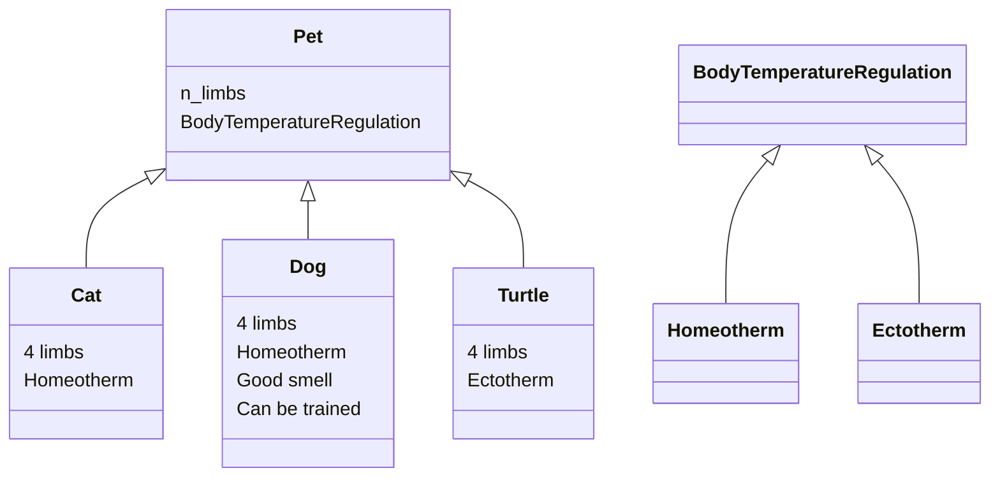

# teaching_patterns

My collection of teaching patterns.

## Patterns

## Anti-patterns

### Deluge

If the exercise is to lift a foot,
there needs to be little talk: just lift that foot!

Example monologue:

- Teacher: a human foot has many bones, joints and muscles.
  It is connected to the lower leg.
  The lower leg has two bones, the thigh bone and the shin bone.
  The lower legs are connected via the knee to the upper leg.
  The upper leg is only one bone.
  Via a so-called 'ball and socket joint' in the hip,
  we can lift our upper leg. As the lower leg is attached to the
  upper leg, and the foot is attached to the lower leg,
  we can lift our foot from our hips.
  Now for the exercises: lift you foot

Problem:

- Not all information is relevant to the exercise

Solution:

- Limit the amount of details added beyond what is needed to be able to
  do the exercise

### Fishing expedition

If the topic is X, stick to talking about X.

Example monologue:

- Teacher: the topic of today is the cat. The cat is a pet.
  There are many other pets, for example dogs and turtles.
  Both cats and dogs and turtles have four limbs. 
  Turtles are ectotherm, or 'cold-blooded', which means that they
  need to be in a warm environment to stay warm. Dogs and cats are
  homeotherm, or 'warm-blooded', so they can survive in a wide
  range of temperatures. Dogs have a good smell and can be trained,
  so the police uses this to find things such as corpses or drugs.

Problem:

- Not all information is relevant for the topic.

Solution:

- Consider if the content is a part-of the topic.
  If needed, increase the scope of the topic.

## Horse without carriage

If you start teaching without building a connection with the learners.

Example monologue:

- Teacher: [1 hour monologue].
  Any questions?
- Learners: [silence]

Problem:

- Without building rapport with the learners and taking them with you,
  you will loose them

Solution:

- Build rapport
- Interact with the learners to make sure they follow along

## Dark Cave

When you teach without monitoring your effectiveness,
similar to teaching painting in a dark cave: you cannot see
and are hence 'teaching in the dark'.

Example monologue:

- Teacher: [60 minutes monologue].
  I see I have run out of time, so I will skip the exercises.

Problem:

- There is no feedback if the learners understood what you tried to teach

Solution:

- Make the learning of the learners visible, so you can conclude how
  effective your teaching was

