# teaching_patterns

My collection of teaching patterns.

## Intro

All patterns and anti-patterns have different examples,
to make them easier to remember.

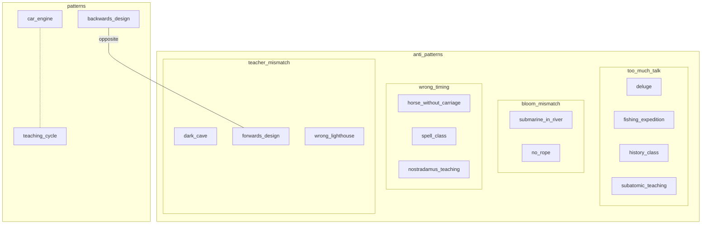

## Patterns

## Backwards design

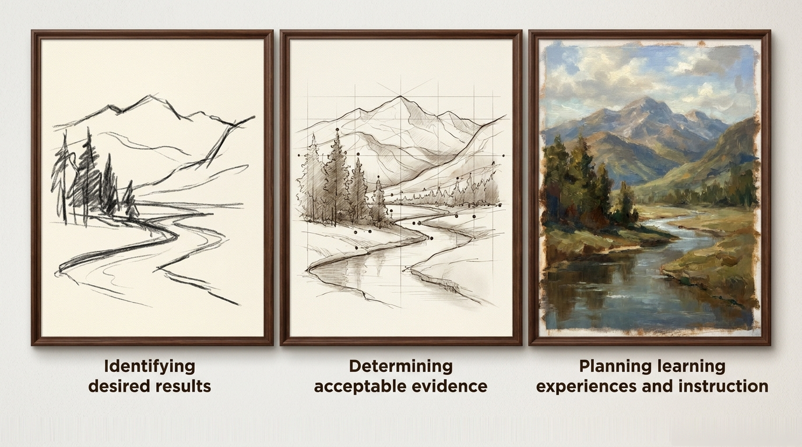

When designing a new lesson, starting with the goal
in mind.

Related patterns: 

- Opposite: [Forwards design](#forwards-design).

## Teaching cycle

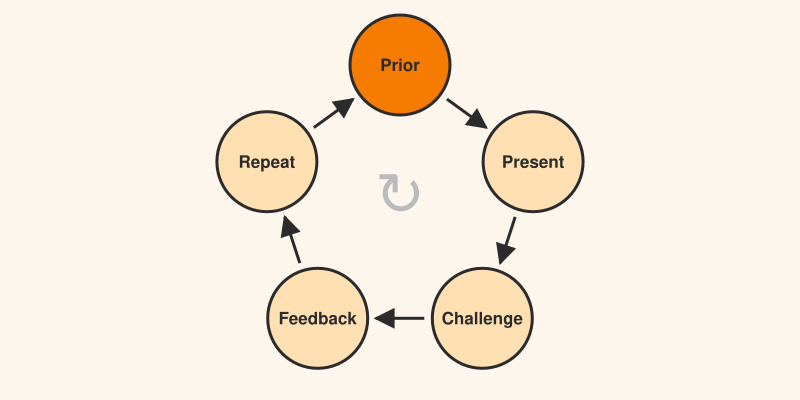

E.g. the evindence-based teaching cycle from Bell:

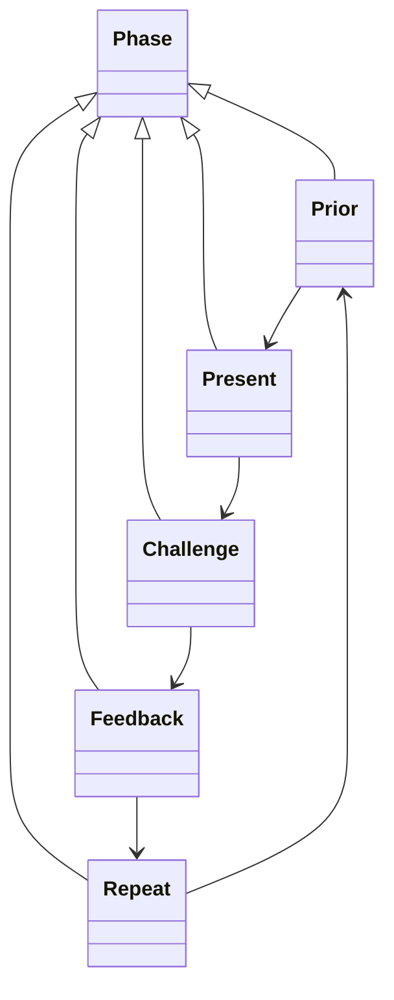

## Car engine

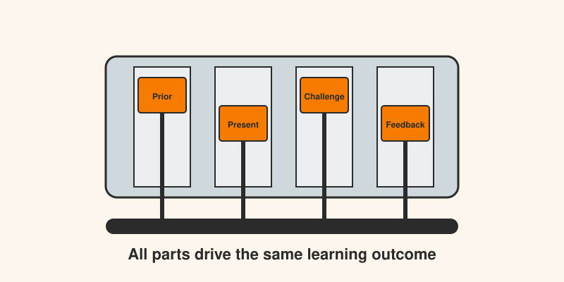

When all the phases of a teaching cycle are about the same learning
outcomes at the same Bloom level, similar to a car engine in which each
piston does a similar thing.

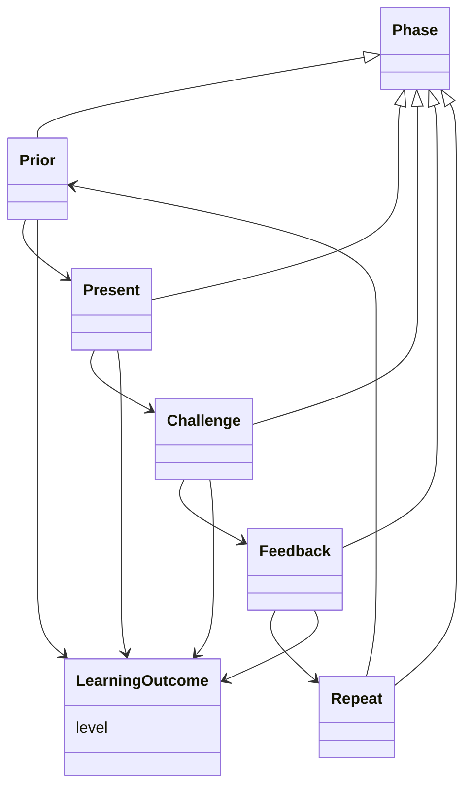

## Anti-patterns

## Dark Cave

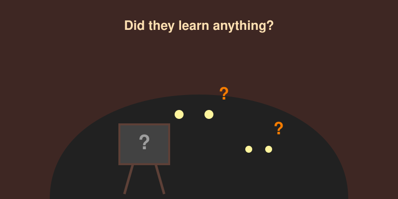

When you teach without monitoring your effectiveness,
similar to teaching painting in a dark cave: you cannot see
and are hence 'teaching in the dark'.

Example monologue:

- Teacher: [60 minutes monologue].
  I see I have run out of time, so I will skip the exercises.

Problem:

- There is no feedback if the learners understood what you tried to teach

Solution:

- Make the learning of the learners visible, so you can conclude how
  effective your teaching was

### Deluge

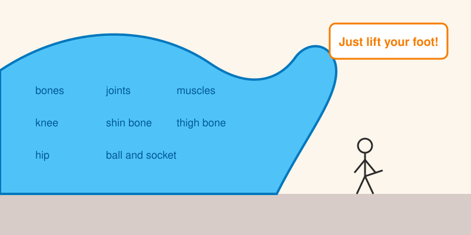

If the exercise is to lift a foot,
there needs to be little talk: just lift that foot!

Example monologue:

- Teacher: a human foot has many bones, joints and muscles.
  It is connected to the lower leg.
  The lower leg has two bones, the thigh bone and the shin bone.
  The lower legs are connected via the knee to the upper leg.
  The upper leg is only one bone.
  Via a so-called 'ball and socket joint' in the hip,
  we can lift our upper leg. As the lower leg is attached to the
  upper leg, and the foot is attached to the lower leg,
  we can lift our foot from our hips.
  Now for the exercises: lift you foot

Problem:

- Not all information is relevant to the exercise

Solution:

- Limit the amount of details added beyond what is needed to be able to
  do the exercise

## Fishing expedition

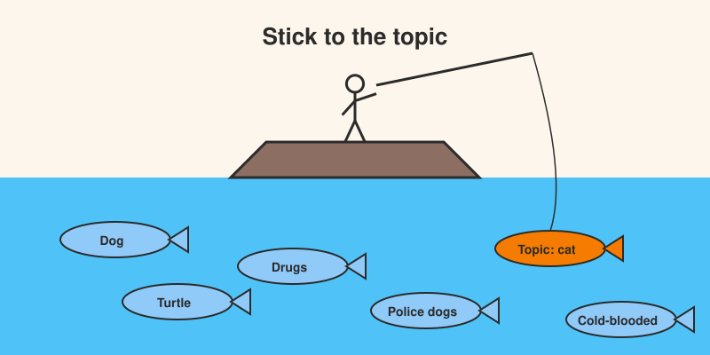

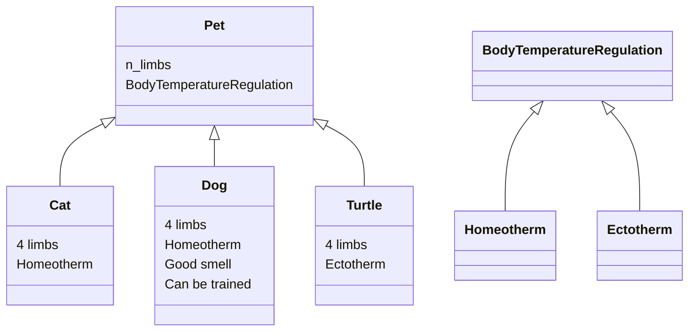

If the topic is X, stick to talking about X.

Example monologue:

- Teacher: the topic of today is the cat. The cat is a pet.
  There are many other pets, for example dogs and turtles.
  Both cats and dogs and turtles have four limbs. 
  Turtles are ectotherm, or 'cold-blooded', which means that they
  need to be in a warm environment to stay warm. Dogs and cats are
  homeotherm, or 'warm-blooded', so they can survive in a wide
  range of temperatures. Dogs have a good smell and can be trained,
  so the police uses this to find things such as corpses or drugs.

Problem:

- Not all information is relevant for the topic.

Solution:

- Consider if the content is a part-of the topic.
  If needed, increase the scope of the topic.

## Forwards design

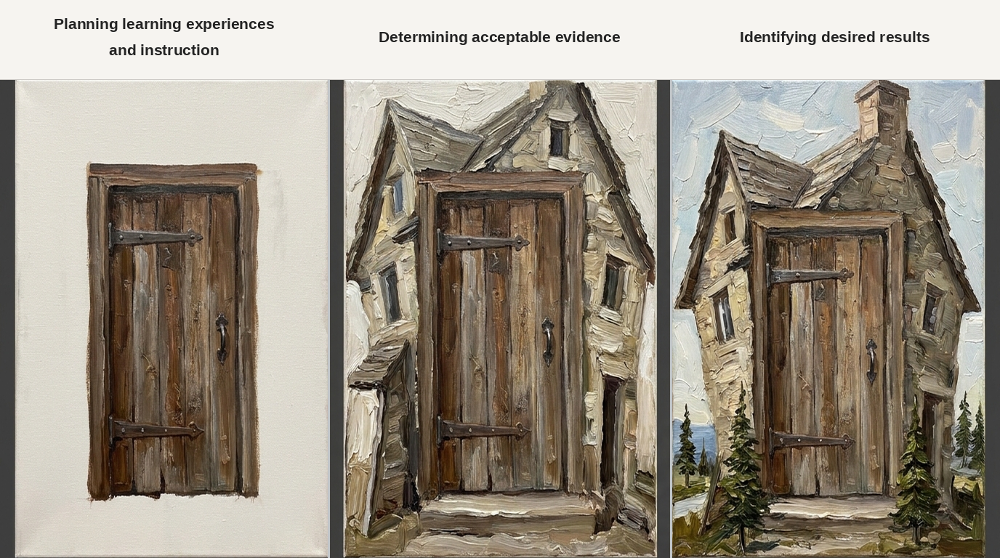

When designing a new lesson, starting with the core of the course content.

Problem:

- Without a goal in mind, your design will be chaotic, such
  as going in circles, losing overview, too much content

Solution:

- Use backwards design instead

Related patterns: 

- Opposite: [Backwards design](#backwards-design).

## Harry Potter spell class

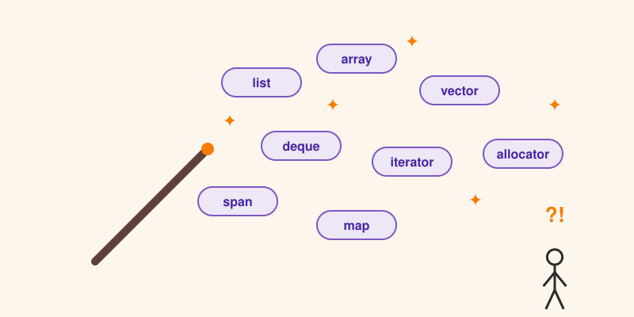

When too many new technical terms are used at the same time,
making it sound as if in an Harry Potter spell class.
 
Example monologue:

- Teacher: Right, I just explained these, now let's compare them.
  In a duel, Protego feels steadier than Expelliarmus,
  Stupefy sounds sharper than Impedimenta, and Petrificus Totalus
  is more decisive than Confundo.
  Finite Incantatem has a cleaner finish than Protego,
  while Expelliarmus is bolder than Stupefy.
  What do you think: does Impedimenta feel more measured than Confundo,
  or is Petrificus Totalus the more decisive choice?
- Teacher: to store many objects, one can use `list`, `array`, `vector`
  and `deque`. `vector` is the default choice for a collection
  of objects. If you want to express the size of this collection, consider
  using `array`. `list` is a `vector` that may be better when you
  need to do many insertions; `vector`
  only allows adding items at the end. If you want to add items at the
  end and beginning, the `deque` may be superior.

Problem:

- Learns can only remember a couple of new terms at the same time

Solution:

- Cut up the theory by exercises in which the learners familiarizes
  him/herself with a smaller set of new terms at the same time

## History class

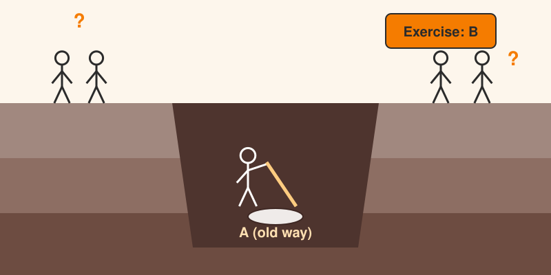

If the theory discusses things that are now longer relevant.

Example monologue:

- Teacher: we used to do A. Doing A was a lot of work.
  Nowadays we do B, which is way easier. In the exercise, do B.

Problem:

- Unless teaching history, the past is irrelevant to solve
  problems in the present

Solution:

- Remove all references to the past that have no relevance
  to the exercises

## Horse without carriage

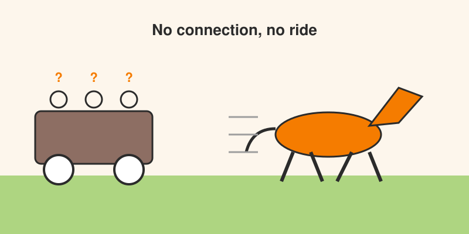

If you start teaching without building rapport (i.e. a connection with the
learners).

Example monologue:

- Teacher: [1 hour monologue].
  Any questions?
- Learners: [silence]

Problem:

- Without building rapport with the learners and taking them with you,
  you will loose them

Solution:

- Build rapport
- Interact with the learners to make sure they follow along

## No rope

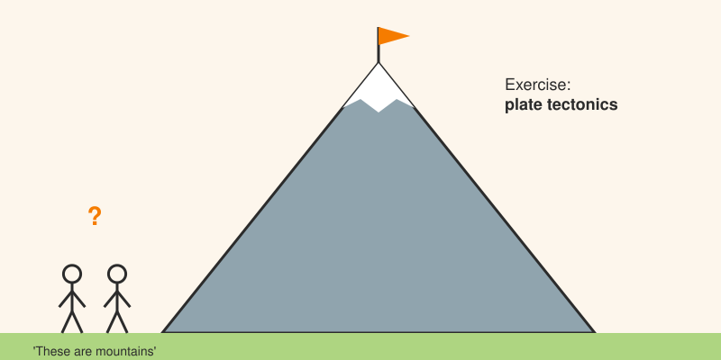

When you teach at a lower Bloom level than the exercises
require: the teacher provides no rope to climb a mountain

Example monologue:

- Teacher: there are many mountains. The Himalayas are mountains.
  The Andes are mountains. The Rocky Mountains are mountains.
  Now for the exercises. Explain the differences between these three
  mountains using plate tectonics.
  
Problem:

- There is a gap between the too-simple explanation and the high-level
  exercise.

Solution:

- Match the level of explanation with the level of the question

## Nostradamus teaching

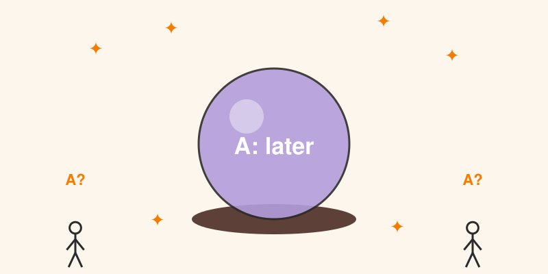

When you forward your own teaching to the future.

Example monologue:

- Teacher: We will talk about A, B and C. I will talk about A later.
  B is easier than A, where C is more complex than A.
  
Problem:

- The learners need the postponed concepts now to understand what this is
  about.
- This is not a problem when this is about course logistics (e.g. 'Later today,
  we will have an evaluation' or 'This will be explored in more detail
  in the exercise')

Solution:

- Reorder your talk.
  Discuss the concepts at the right time, limit moving things to the future.

## Subatomic teaching

When you teach in more detail than is relevant.

- Teacher: the water molecule consists out of hydrogen and
  oxygen.
  Hydrogen has one proton and one electron,
  but it can also have one or two more neutrons.
  Oxygen has 8 protons, 8 electrons and 8-10 neutrons.
  What kind of gases can theoretically form from water?

Problem:

- The details are irrelevant

Solution:

- Remove the irrelevant details 

## Submarine in river

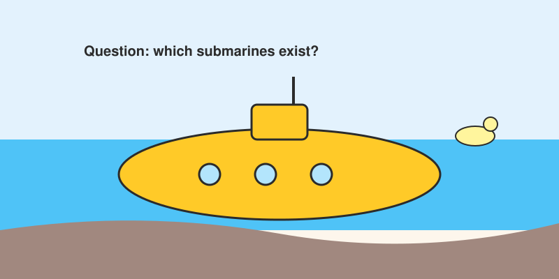

When you teach at a deeper Bloom level than the exercises
require: one takes a submarine to dive to the bottom of a river.

Example monologue:

- Teacher: [monologue that evaluates the pros and cons of multiple
  types of submarines].
  Now for the exercises. Which types of submarines are there?
  
Problem:

- There is a gap between the too-complex explanation and the basic
  exercise.

Solution:

- Match the level of explanation with the level of the question

## Wrong lighthouse

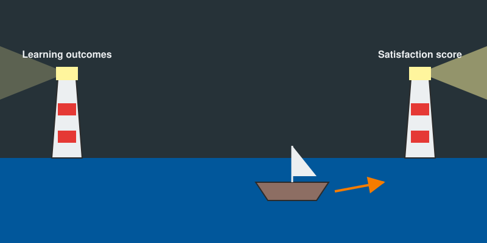

When you listen to the wrong information to improve your teaching,
similar to a boat going to the wrong lighthouse.

Examples:

- 'Rate the course' asked to learners: there is no evidence for
  correlation with course quality
- 'How satisfied are you with the course?' asked to learners:
  there is no evidence for
  correlation with course quality
- 'Would you recommend this course?' asked to learners:
  correlates most strongly with the help provided by the
  tutors
- 'How confident are you in [learning outcome]?' asked to learners:
  learners cannot assess their own skill, hence this question cannot
  be used to assess to which extent the learning outcomes have been
  achieved

Solutions:

- To grow as a teacher: do peer observation with another teacher
- To assess to which extent the learning outcomes have been
  achieved: use tests

  
<!-- 

Misc notes

- What are the equivalent to functions, classes, variables?
  I feel the Bloom verbs are functions.

-->

